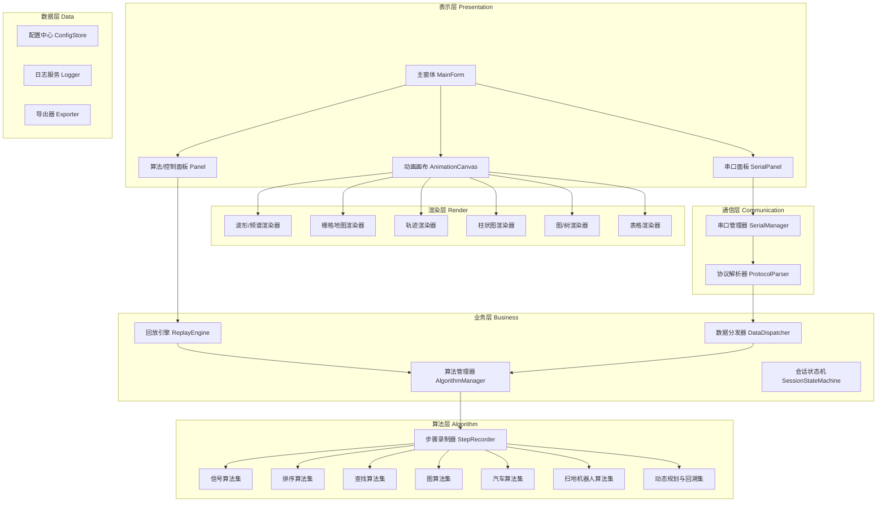
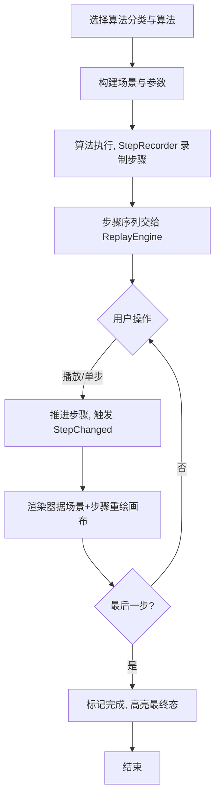
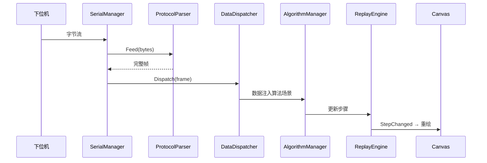
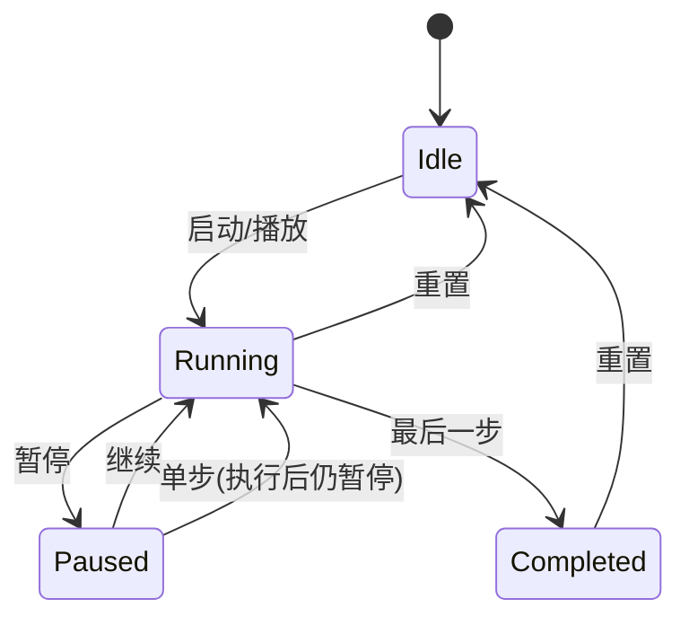

# 算法动画上位机 · 软件设计文档（SDD）

## 1. 文档信息

| 项目 | 内容 |
| --- | --- |
| 文档名称 | 算法动画上位机 软件设计文档 |
| 版本 | v0.4 |
| 日期 | 2026-10-17 |
| 状态 | 草稿 |

### 1.1 修订记录

| 版本 | 日期 | 修订说明 |
| --- | --- | --- |
| v0.1 | 2026-10-17 | 初稿（算法动画 + 上位机） |
| v0.2 | 2026-10-17 | 聚焦上位机，移除算法动画 |
| v0.3 | 2026-10-17 | 明确四类算法，整合上位机与算法动画 |
| v0.4 | 2026-10-17 | 扩充算法库为 7 大类约 50 个算法，分类整理 |

---

## 2. 概述

### 2.1 背景与目标

基于 C# WinForms 开发一套**算法动画上位机**：既能与下位机串口通信（采集数据、下发指令），又能以动画直观展示算法执行过程。

算法库共 **7 大类、约 50 个算法**：

| 分类 | 可视化形态 |
| --- | --- |
| 信号算法 | 波形图、频谱图 |
| 排序算法 | 柱状图 |
| 查找算法 | 柱状图、树 |
| 图算法 | 图、栅格 |
| 汽车算法 | 2D 轨迹、响应曲线、俯视图 |
| 扫地机器人算法 | 栅格地图 + 机器人 |
| 动态规划与回溯 | 表格、栅格 |

### 2.2 成功指标

- 动画播放帧率 ≥ 30 FPS（栅格 ≤ 200×200，波形窗口 ≤ 5000 点）。
- 串口收发稳定，115200 波特率下连续运行 24h 无崩溃、无内存泄漏。
- 支持 7 类算法、约 50 个算法动画。
- 串口数据到动画更新的端到端延迟 < 100ms。

### 2.3 范围

| 范围内（In Scope） | 范围外（Out of Scope） |
| --- | --- |
| 7 类算法动画 | 下位机固件开发 |
| 串口通信与协议帧解析 | 无线通信（蓝牙/Wi-Fi/TCP） |
| 动画播放控制（播放/暂停/单步/调速） | 3D 渲染、真实物理仿真 |
| 指令下发与参数配置 | 云端上传、多机协同 |
| 数据记录与导出（CSV） | 代码编辑/调试 IDE |

---

## 3. 干系人与角色

| 角色 | 说明 | 主要诉求 |
| --- | --- | --- |
| 算法学习者/教师 | 观看算法演示 | 动画清晰、可单步讲解 |
| 嵌入式/机器人工程师 | 调试下位机、验证算法 | 串口稳定、算法可视化直观 |
| 开发者 | 扩展新算法/渲染形态 | 接口统一、易扩展 |

---

## 4. 术语表

| 术语 | 定义 |
| --- | --- |
| 上位机 | 运行于 PC、与下位机通信并实现人机交互的软件 |
| 下位机 | 与被控对象相连的硬件（MCU、智能车、扫地机器人等） |
| 步骤序列（Trace） | 算法运行中记录的原子操作有序集合 |
| 回放引擎（Replay Engine） | 按节奏将步骤序列渲染成动画的组件 |
| 渲染器（Renderer） | 将算法场景 + 当前步骤绘制到画布的组件 |
| 栅格地图 | 将空间划分为网格，用于扫地/寻路算法的环境表示 |

---

## 5. 总体架构

### 5.1 技术选型

| 类别 | 选择 | 说明 |
| --- | --- | --- |
| 语言/框架 | C# + WinForms，.NET 8（LTS） | 兼容备选：.NET Framework 4.8 |
| 渲染 | GDI+ 双缓冲 | 波形/栅格/柱状图绘制，简单高效 |
| 串口 | `System.IO.Ports.SerialPort` | 系统内置，成熟稳定 |
| 配置 | JSON（`System.Text.Json`） | 保存串口参数、偏好 |
| 日志 | Serilog | 文件滚动日志 |
| 导出 | CsvHelper | CSV 导出 |

### 5.2 分层架构



### 5.3 核心设计思想

1. **算法与动画解耦**：算法只负责「执行 + 通过 `StepRecorder` 记录步骤」，不直接操作 UI；回放引擎统一消费步骤，渲染器负责绘制。
2. **统一算法接口 + 多形态渲染器**：7 类算法共享 `IAlgorithm` 接口，差异体现在「场景模型」与「渲染器」上。
3. **事件驱动**：算法层/通信层通过事件向业务层广播，降低耦合。
4. **生产者-消费者**：串口读取线程写入并发队列，数据分发异步消费，避免阻塞串口。
5. **状态机**：动画会话状态统一由 `SessionStateMachine` 管理。

---

## 6. 算法分类与内容

### 6.1 信号算法（Signal）— 波形图 / 频谱图

| 编号 | 算法 | 形态 | 说明 |
| --- | --- | --- | --- |
| SIG-01 | 信号生成 | 波形图 | 正弦/方波/三角/锯齿/噪声 |
| SIG-02 | 滑动平均滤波 | 波形对比 | 原始波 vs 滤波波 |
| SIG-03 | 中值滤波 | 波形对比 | 去毛刺 |
| SIG-04 | 数字滤波 FIR/IIR | 波形对比 | 巴特沃斯等 |
| SIG-05 | 卡尔曼滤波 | 波形对比 | 预测-更新两步可视化 |
| SIG-06 | FFT 频谱分析 | 频谱图 | 时域→频域，峰值高亮 |
| SIG-07 | FFT 加窗 | 频谱图 | 汉宁/汉明窗，频谱泄漏 |
| SIG-08 | 峰值/过零检测 | 波形图 | 峰值点、过零点标记 |
| SIG-09 | 包络检测 | 波形图 | 叠加包络线 |
| SIG-10 | 自相关/互相关 | 波形图 | 周期检测、时延估计 |
| SIG-11 | 最小二乘拟合 | 波形图 | 拟合曲线与残差 |

### 6.2 排序算法（Sorting）— 柱状图

| 编号 | 算法 | 说明 |
| --- | --- | --- |
| SORT-01 | 冒泡排序 | 相邻比较交换 |
| SORT-02 | 选择排序 | 找最值交换 |
| SORT-03 | 插入排序 | 局部有序插入 |
| SORT-04 | 快速排序 | 分区 + 递归 |
| SORT-05 | 归并排序 | 分治 + 合并 |
| SORT-06 | 堆排序 | 建堆 + 调整 |

### 6.3 查找算法（Search）— 柱状图 / 树

| 编号 | 算法 | 形态 | 说明 |
| --- | --- | --- | --- |
| SEA-01 | 顺序查找 | 柱状图 | 逐个访问高亮 |
| SEA-02 | 二分查找 | 柱状图 | 区间收缩高亮 |
| SEA-03 | 插值查找 | 柱状图 | 二分变体 |
| SEA-04 | 哈希查找 | 桶状图 | 桶与冲突可视化 |
| SEA-05 | 二叉搜索树 | 树 | 插入/查找/删除 |
| SEA-06 | KMP 字符串匹配 | 数组对比 | next 失配数组可视化 |

### 6.4 图算法（Graph）— 图 / 栅格

| 编号 | 算法 | 说明 |
| --- | --- | --- |
| GRAPH-01 | DFS 深度优先 | 访问顺序、栈 |
| GRAPH-02 | BFS 广度优先 | 访问顺序、队列 |
| GRAPH-03 | Dijkstra 最短路 | 代价与路径高亮 |
| GRAPH-04 | A* 寻路 | 启发式搜索，栅格 |
| GRAPH-05 | 最小生成树 Prim/Kruskal | 边选择过程 |
| GRAPH-06 | 拓扑排序 | 依赖关系可视化 |
| GRAPH-07 | 并查集/连通分量 | 集合合并过程 |

### 6.5 汽车算法（Automotive）— 轨迹 / 响应曲线 / 俯视图

| 编号 | 算法 | 形态 | 说明 |
| --- | --- | --- | --- |
| CAR-01 | PID 闭环控制 | 响应曲线 | 目标/实际/误差 |
| CAR-02 | 前馈+反馈控制 | 响应曲线 | 与 PID 对比 |
| CAR-03 | 循迹/路径跟踪 | 轨迹图 | 参考 vs 实际 |
| CAR-04 | Pure Pursuit/Stanley | 轨迹图 | 跟踪进阶 |
| CAR-05 | 避障规划 | 栅格+轨迹 | 障碍与规划路径 |
| CAR-06 | RRT 路径规划 | 栅格+树 | 采样树生长 |
| CAR-07 | 自动泊车 | 俯视图 | 车位、位姿、路径 |
| CAR-08 | 航位推算 | 俯视图 | 位姿估计与漂移 |
| CAR-09 | 路径平滑 | 轨迹图 | 贝塞尔/样条 |
| CAR-10 | MPC 模型预测 | 响应曲线 | 预测时域滚动 |

### 6.6 扫地机器人算法（Vacuum）— 栅格地图

| 编号 | 算法 | 说明 |
| --- | --- | --- |
| VAC-01 | 随机碰撞式清扫 | 基础覆盖策略 |
| VAC-02 | 弓字型覆盖清扫 | 蛇形路径，已扫/未扫 |
| VAC-03 | 螺旋清扫 | 螺旋覆盖 |
| VAC-04 | 沿边清扫 | 沿墙边界行进 |
| VAC-05 | 房间分割清扫 | 分区后逐区清扫 |
| VAC-06 | 避障/脱困 | 障碍检测与绕行 |
| VAC-07 | 回充路径规划 | A* 回充电桩 |
| VAC-08 | 断点续扫 | 回充后返回断点 |
| VAC-09 | 简单 SLAM 建图 | 边扫边建图 |

### 6.7 动态规划与回溯（DP / Backtracking）— 表格 / 栅格

| 编号 | 算法 | 形态 | 说明 |
| --- | --- | --- | --- |
| DP-01 | 斐波那契 | 表格 | 递推填值 |
| DP-02 | 0-1 背包 | 表格 | 状态转移填表 |
| DP-03 | LCS 最长公共子序列 | 表格 | 方向回溯 |
| DP-04 | 迷宫求解 | 栅格 | 回溯 + 路径 |
| DP-05 | N 皇后 | 棋盘 | 回溯 + 剪枝 |

---

## 7. 模块详细设计

### 7.1 算法层：统一接口与步骤录制

```csharp
// 动画原子操作类型
public enum AnimOp
{
    Compare, Swap, Assign, Visit,   // 数组/查找类
    Highlight,                      // 高亮元素/节点
    SetRange,                       // 标记区间（已排序/已扫）
    PlotPoint,                      // 波形/频谱绘制采样点
    Move,                           // 机器人/车辆移动位姿
    SetPath,                        // 设置/高亮路径
    MarkGrid,                       // 标记栅格单元
    SetPointer,                     // 移动指针
    FillCell                        // 填充表格/DP 单元
}

// 动画步骤（统一，兼容 7 类算法）
public class AnimStep
{
    public AnimOp Op;
    public int[] Indices;           // 数组/节点索引
    public PointF[] Points;         // 坐标（栅格/轨迹/波形）
    public object Extra;            // 附加数据（位姿、颜色等）
    public string Description;
    public int Sequence;
}

// 步骤录制器（算法调用端）
public class StepRecorder
{
    public void Record(AnimStep step);
    public IReadOnlyList<AnimStep> Trace { get; }
}

// 算法统一接口
public interface IAlgorithm
{
    string Category { get; }        // 信号/排序/查找/图/汽车/扫地/DP
    string Name { get; }
    string Description { get; }
    void Run(AlgorithmContext ctx, StepRecorder recorder);
}

// 算法场景上下文（不同算法携带不同场景数据）
public class AlgorithmContext
{
    public int[] Array;             // 数组（排序/查找）
    public double[] Signal;         // 信号采样
    public GridMap Map;             // 栅格地图（扫地/寻路）
    public Graph Graph;             // 图（DFS/BFS/Dijkstra）
    public TreeNode Tree;           // 树（二叉搜索树）
    public int[][] DpTable;         // DP 表格
    public RobotPose Pose;          // 位姿（汽车/扫地）
}
```

### 7.2 业务层：动画回放引擎

```csharp
public class ReplayEngine
{
    public IReadOnlyList<AnimStep> Steps { get; set; }
    public int Speed { get; set; }               // 1~100，映射为每步延时
    public event Action<AnimStep> StepChanged;
    public event Action Completed;

    public void Play();
    public void Pause();
    public void StepForward();
    public void Reset();
    public void SeekTo(int sequence);
}
```

- 使用 `System.Windows.Forms.Timer`（UI 线程）驱动，延时 = `f(Speed)`。
- 每步触发 `StepChanged`，画布据当前步骤 + 场景快照重绘。

### 7.3 渲染层：多形态渲染器

| 渲染器 | 适用算法 | 绘制内容 |
| --- | --- | --- |
| `WaveformRenderer` | 信号 | 坐标轴、波形、峰值/过零/包络标记 |
| `SpectrumRenderer` | FFT | 频谱柱、主频峰值高亮 |
| `GridMapRenderer` | 扫地/寻路 | 栅格单元、障碍、路径、机器人图标 |
| `TrajectoryRenderer` | 汽车 | 2D 俯视轨迹、参考路径、车辆位姿 |
| `ChartRenderer` | 排序/查找 | 柱状图，高亮比较/访问元素 |
| `GraphRenderer` | 图 | 节点、边、访问状态、最短路径 |
| `TreeRenderer` | 二叉搜索树 | 树节点、边、访问高亮 |
| `TableRenderer` | DP | 表格填值、方向回溯、棋盘 |

```csharp
public interface IAnimRenderer
{
    void Render(Graphics g, Rectangle bounds, AlgorithmContext ctx, AnimStep current);
}
```

### 7.4 通信层：串口管理与协议解析

```csharp
public class SerialConfig
{
    public string PortName { get; set; } = "COM1";
    public int BaudRate { get; set; } = 115200;
    public int DataBits { get; set; } = 8;
    public Parity Parity { get; set; } = Parity.None;
    public StopBits StopBits { get; set; } = StopBits.One;
}

public class SerialManager : IDisposable
{
    public bool Open(SerialConfig cfg);
    public void Close();
    public void Send(byte[] data);
    public event Action<byte[]> RawDataReceived;
    public event Action<Frame> FrameReceived;
    public event Action<bool> ConnectionChanged;
    public bool AutoReconnect { get; set; }
}
```

**默认协议帧格式**（可配置）：

```
| 帧头 0xAA 0x55 | 类型 Type(1B) | 长度 Len(2B, 小端) | 载荷 Payload(Len B) | 校验 XOR(1B) |
```

**帧类型约定**：

| Type | 方向 | 含义 |
| --- | --- | --- |
| 0x01 | 下位机→上位机 | 采样数据帧（驱动信号/状态动画） |
| 0x02 | 下位机→上位机 | 状态/应答帧 |
| 0x03 | 上位机→下位机 | 参数配置帧 |
| 0x04 | 上位机→下位机 | 控制指令帧（启停/复位） |

`ProtocolParser` 维护接收缓冲，按「帧头→类型→长度→载荷→校验」状态机切分，自动处理粘包/半包，校验失败丢弃并计数。

### 7.5 业务层：数据分发器

```csharp
public class DataDispatcher
{
    public void Dispatch(Frame frame);
    public event Action<Sample> SampleArrived;   // 采样数据 → 算法/动画
    public event Action<DeviceStatus> StatusArrived;
}
```

- 采样数据帧解析为通道值后，可注入对应算法场景，驱动动画更新（如把实时信号送入波形渲染器）。

### 7.6 数据层

- `ConfigStore`：保存/恢复串口参数、窗口布局、播放速度。
- `Exporter`：将算法步骤序列、采样数据导出 CSV。
- 日志：Serilog 文件滚动日志。

---

## 8. 界面设计

### 8.1 整体框架（主菜单 + 左侧子导航 + 内容区）

主窗体采用**顶部主菜单栏 + 左侧子导航栏 + 内容区**三层结构：

- 顶部「导航栏」菜单下拉选择大类（串口 / 算法动画）。
- 左侧子导航栏**随导航栏选择而变化**，列出当前大类下的子功能或算法分类。
- 内容区随左侧子导航选择而变化。

```text
┌────────────────────────────────────────────────────────────────────────┐
│ 文件(F)  视图(V)  导航栏(N)  帮助(H)                             ─ □ ✕ │
│                       ┌──────────┐                                     │
│                       │ 串口     │  ← 导航栏下拉（一级导航）            │
│                       │ 算法动画 │                                     │
│                       └──────────┘                                     │
├────────────────┬───────────────────────────────────────────────────────┤
│  左侧子导航栏   │                    内容区                            │
│  （随导航栏    │            （随左侧子导航选择而变化）                  │
│   选择而变化） │                                                       │
│                │                                                       │
│  选「串口」时： │                                                       │
│   ▣ 串口设置   │                                                       │
│   ▣ 接收显示   │                                                       │
│   ▣ 发送指令   │                                                       │
│   ▣ 实时曲线   │                                                       │
│   ▣ 日志      │                                                       │
│                │                                                       │
├────────────────┴───────────────────────────────────────────────────────┤
│ ●已连接COM3 │ 当前:串口/接收显示 │ RX:12345 │ TX:678 │ 坏帧:0 │ FPS   │
└────────────────────────────────────────────────────────────────────────┘
```

- 页面复用 `SerialPage`、`AlgorithmPage` 两个 `UserControl`；串口对象（`SerialManager`）由主窗体持有、依赖注入给两页，实现「串口收数据 → 算法动画」跨页联动。

### 8.2 页面一：串口上位机

导航栏选择「串口」后，左侧子导航栏列出 5 项，内容区随选中项切换：

| 左侧子导航项 | 内容区 |
| --- | --- |
| 串口设置 | 连接栏：端口/波特率/数据位/校验/停止位 ComboBox、打开开关、自动重连 |
| 接收显示 | 接收数据区：HEX/ASCII 切换、暂停滚动、清空、收发计数 |
| 发送指令 | 发送面板：指令输入（HEX/ASCII）、发送、定时循环发送、快捷指令 |
| 实时曲线 | 多通道波形图（ChartPanel，双缓冲，可缩放/暂停/图例） |
| 日志 | 分级日志，清空、导出 |

```text
┌──────────────────────────────────────────────────────────────────────────┐
│ [● 打开串口] 端口[COM3▾] 波特率[115200▾] 数据位[8▾] 校验[无▾] 停止位[1▾] ☑自动重连 │
├─────────────────────────────────────┬────────────────────────────────────┤
│ 接收显示  [HEX▾][ASCII][暂停][清空] │  发送面板  [HEX▾][循环发送☐]       │
│                                     │  ┌──────────────────────────────┐ │
│  AA 55 01 0A 00 12 34 ...           │  │ AA 55 04 01 ...              │ │
│  ...                                │  └──────────────────────────────┘ │
│                                     │  [ 发送 ]  [ 清空 ]               │
│                                     │  快捷指令: [启动][停止][复位][查询] │
├─────────────────────────────────────┴────────────────────────────────────┤
│ 实时曲线（多通道波形，可缩放/暂停）                                        │
│  ▲   ── 通道1  ── 通道2                                                │
│  │   ╱╲  ╱╲                                                            │
│  │  ╱  ╲╱  ╲___                                                        │
│  └──────────────────────────────────────▶ 时间                          │
├──────────────────────────────────────────────────────────────────────────┤
│ 日志  [INFO] 12:00:01 串口已打开  [清空][导出]                            │
└──────────────────────────────────────────────────────────────────────────┘
```

> 注：上图串联显示串口页全部功能区；实际界面按左侧子导航选中项，仅展示对应内容区。

### 8.3 页面二：算法动画（参考 VisuAlgo 设计）

算法动画页参考 [VisuAlgo](https://visualgo.net/zh) 的交互范式，采用「顶部算法切换 + 中央画布 + 右侧伪代码 + 底部播放控制」四区布局：

```text
┌────────────────────────────────────────────────────────────────────────────┐
│ 算法切换：[冒泡][选择][插入][归并][快速]        ← 当前分类下的算法按钮组    │
├───────────────────────────────┬────────────────────────────────────────────┤
│                               │  伪代码面板                                │
│         动画画布              │  1  for i = 0 to n-2                       │
│  （数据可视化，高亮当前操作）   │  2    for j = 0 to n-i-2                   │
│                               │  3      if A[j] > A[j+1]      ← 高亮当前行  │
│                               │  4        swap(A[j], A[j+1])                │
│                               │  5  end                                    │
├───────────────────────────────┴────────────────────────────────────────────┤
│ 当前操作：比较 A[3] 与 A[4]（15 > 7，交换）                                  │
├────────────────────────────────────────────────────────────────────────────┤
│ ⏮ │ ▶ │ ⏭ │ 进度 [██████──────] 5/120 │ 速度 ────●──── 1.0x │ N[100▾] 分布[随机▾] [新建] │
└────────────────────────────────────────────────────────────────────────────┘
```

**区域说明**：

| 区域 | 位置 | 说明 |
| --- | --- | --- |
| 算法切换 | 顶部 | 当前分类下的算法按钮组（如排序：冒泡/选择/插入/归并/快速/计数/基数），选中高亮 |
| 动画画布 | 中央 | 数据可视化，高亮当前比较/交换/已排序/枢轴等元素 |
| 伪代码面板 | 右侧 | 显示当前算法伪代码，随回放高亮当前执行行 |
| 操作说明 | 画布下 | 一句话解释当前步骤（如「比较 A[3] 与 A[4]，需交换」） |
| 播放控制 | 底部 | 后退/前进、播放/暂停、进度条、速度滑块 |
| 数据设置 | 底部 | 数据规模 N、数据分布（随机/有序/逆序/几乎有序/多重复）、新建数据 |

**播放控制**：

| 控件 | 功能 |
| --- | --- |
| ⏮ 后退 | 回退一步 |
| ▶ / ⏸ 播放 / 暂停 | 连续回放 / 暂停 |
| ⏭ 前进 | 前进一步 |
| 进度条 | 当前步/总步数，可拖动定位 |
| 速度滑块 | 0.5x~2.0x 回放节奏 |
| 键盘快捷键 | 空格=播放/暂停，←/→=后退/前进，- / +=减速/加速 |

**动态参数**：

| 算法分类 | 动态参数 |
| --- | --- |
| 信号算法 | 采样率、频率、窗口宽度、噪声幅度 |
| 汽车算法 | 目标值、Kp/Ki/Kd、参考路径、车速 |
| 扫地机器算法 | 地图宽高、障碍密度、起始位置 |
| 查找算法 | 数据规模、数据分布、查找目标 |

### 8.4 主菜单栏

| 菜单 | 子项 |
| --- | --- |
| 文件 | 打开配置、保存配置、导出数据(CSV)、退出 |
| 视图 | 深浅主题、全屏 |
| 导航栏 | 串口、算法动画（选择大类，驱动左侧子导航栏变化） |
| 帮助 | 使用说明、关于 |

### 8.5 导航栏（一级 + 左侧二级子导航）

**一级导航**：主菜单「导航栏」下拉，两项选择大类，当前项打勾高亮。

| 一级导航项 | 对应页面 |
| --- | --- |
| 串口 | `SerialPage` |
| 算法动画 | `AlgorithmPage` |

**二级导航（左侧子导航栏）**：随一级导航选择而变化：

| 一级选择 | 左侧子导航栏项 |
| --- | --- |
| 串口 | 串口设置、接收显示、发送指令、实时曲线、日志 |
| 算法动画 | 信号算法、汽车算法、扫地机器算法、查找算法 |

### 8.6 状态栏

左→右：串口连接状态灯（●已连接/○未连接）、当前一级/二级导航（如「串口 / 接收显示」）、RX/TX 字节数、坏帧计数、FPS（算法动画回放时）。

### 8.7 控件清单

| 页面 | 区域 | 控件 |
| --- | --- | --- |
| 主窗体 | 顶部 | MenuStrip（文件/视图/导航栏/帮助） |
| 主窗体 | 左侧 | 子导航栏（ListView/自定义列表，随导航栏选择变化） |
| 主窗体 | 底部 | StatusStrip |
| 串口页 | 连接栏 | ComboBox×5、Button、CheckBox |
| 串口页 | 接收显示 | RichTextBox、ToolStrip |
| 串口页 | 发送 | TextBox、Button、快捷指令按钮 |
| 串口页 | 曲线 | ChartPanel（自定义） |
| 串口页 | 日志 | RichTextBox |
| 算法页 | 顶部 | 算法切换按钮组（RoundedButton，选中高亮） |
| 算法页 | 画布 | AnimationCanvas（自定义） |
| 算法页 | 伪代码 | PseudoCodePanel（自定义，高亮当前行） |
| 算法页 | 操作说明 | Label |
| 算法页 | 底部 | 播放控制栏（后退/前进/播放/暂停 + 进度条 + 速度滑块） |
| 算法页 | 数据设置 | 数据规模 ComboBox + 分布 ComboBox + 新建按钮 |

### 8.8 关键交互

| 交互 | 行为 |
| --- | --- |
| 导航栏选择「串口/算法动画」 | 主窗体切换页面，并刷新左侧子导航栏 |
| 点击左侧子导航项 | 内容区切换到对应功能/算法分类 |
| 算法页点击算法切换按钮 | 切换当前算法，重建场景并重置回放 |
| 「后退/前进」 | 回退/前进一步 |
| 「播放/暂停」 | 连续回放 / 暂停 |
| 拖动进度条 | 定位到指定步骤 |
| 拖动速度滑块 | 实时调整回放节奏（0.5x~2.0x） |
| 键盘空格 / ←→ / -+ | 播放暂停 / 后退前进 / 减速加速 |
| 数据设置「新建」 | 按 N 与分布重新生成数据并重置 |
| 串口页打开串口接收 0x01 帧 | 数据可注入算法页场景，驱动动画（跨页联动） |
| 串口页点击「发送」 | 下发控制/参数指令 |
| 算法页画布滚轮/拖拽 | 缩放/平移（图/栅格类） |

---

## 9. 关键流程

### 9.1 算法动画主流程



### 9.2 串口数据驱动动画流程



### 9.3 动画会话状态机



---

## 10. 非功能需求

| 编号 | 类别 | 需求描述 | 度量指标 | 优先级 |
| --- | --- | --- | --- | --- |
| NFR-001 | 性能 | 动画流畅 | ≥ 30 FPS（5000 点/200×200） | Must |
| NFR-002 | 可靠性 | 长时间稳定 | 24h 无崩溃、无内存泄漏 | Must |
| NFR-003 | 可用性 | 操作直观 | 5 分钟内完成首次演示 | Should |
| NFR-004 | 兼容性 | 系统兼容 | Windows 10/11 | Must |
| NFR-005 | 可维护性 | 易扩展 | 新增算法/渲染器零改动核心 | Should |
| NFR-006 | 安全性 | 异常隔离 | 坏帧/断线不崩溃、不卡死 | Must |

---

## 11. 数据结构设计

| 编号 | 实体 | 关键字段 | 说明 |
| --- | --- | --- | --- |
| DE-001 | AnimStep | Op、Indices[]、Points[]、Description、Sequence | 动画步骤 |
| DE-002 | Frame | Type、Payload[]、Timestamp、CheckOk | 协议帧 |
| DE-003 | SerialConfig | PortName、BaudRate、DataBits、Parity、StopBits | 串口参数 |
| DE-004 | GridMap | Width、Height、Cells[]（空闲/障碍/已扫） | 栅格地图 |
| DE-005 | Graph | Nodes[]、Edges[] | 图 |
| DE-006 | TreeNode | Value、Left、Right | 树节点 |
| DE-007 | RobotPose | X、Y、Heading | 位姿 |
| DE-008 | Sample | Timestamp、Values[] | 采样点 |

---

## 12. 开发计划

| 阶段 | 交付内容 | 里程碑 |
| --- | --- | --- |
| M1 | 工程骨架 + 主窗体 + 串口管理器 | 可打开/关闭串口、收发字节 |
| M2 | 步骤录制 + 回放引擎 + 排序/查找动画 | 柱状图算法可播放 |
| M3 | 信号算法动画（波形/频谱渲染） | 滤波/FFT 可视化 |
| M4 | 图算法 + 树/表格渲染 | DFS/BFS/Dijkstra/DP 可视化 |
| M5 | 扫地机器人算法动画（栅格地图） | 覆盖清扫/SLAM 可视化 |
| M6 | 汽车算法动画（轨迹/响应曲线） | PID/循迹/泊车/RRT 可视化 |
| M7 | 串口数据驱动动画 + 指令下发 | 上位机联动完成 |
| M8 | 数据导出 + 日志 + 配置持久化 | 全功能交付 |

---

## 13. 假设与待确认问题

### 13.1 已确认假设（Assumption）

| 编号 | 假设内容 |
| --- | --- |
| A-001 | 通信方式为串口，协议帧为「帧头+类型+长度+载荷+XOR校验」自定义格式 |
| A-002 | 下位机固件不在本项目范围内，仅约定通信协议 |
| A-003 | 使用 .NET 8 + WinForms + GDI+ 双缓冲 |
| A-004 | 「汽车算法」指智能车/自动驾驶相关算法（PID、循迹、泊车、避障） |

### 13.2 待确认问题（Open Questions）

| 编号 | 问题 | 影响范围 | 默认方案 |
| --- | --- | --- | --- |
| Q-001 | 具体对接哪类下位机？帧格式是否已固定？ | 通信层 | 自定义通用帧，可配置 |
| Q-002 | 每类算法清单是否还有遗漏？ | 算法层 | 按第 6 节清单实现 |
| Q-003 | 「汽车算法」是否还含 CAN 总线/ECU 数据解析？ | 算法层/通信 | 暂不做，仅算法动画 |
| Q-004 | 是否需要中文/英文双语界面？ | 表示层 | 仅中文 |
